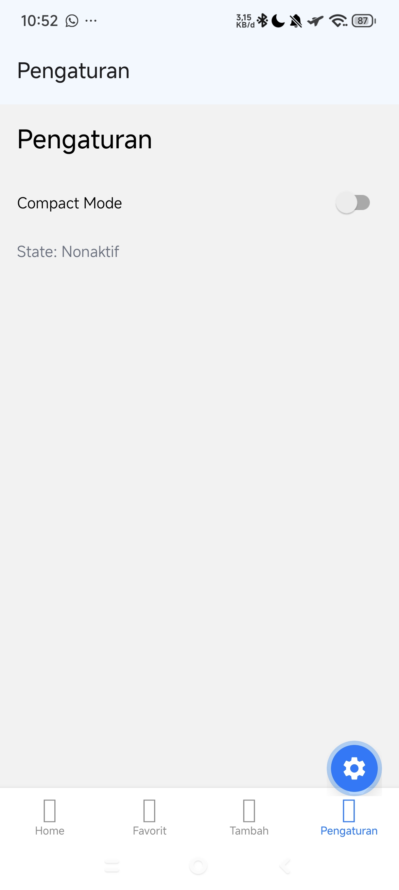
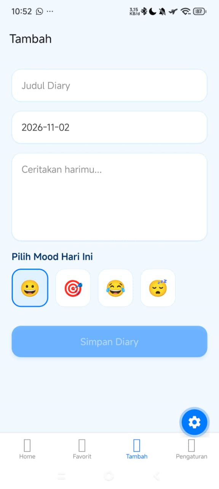
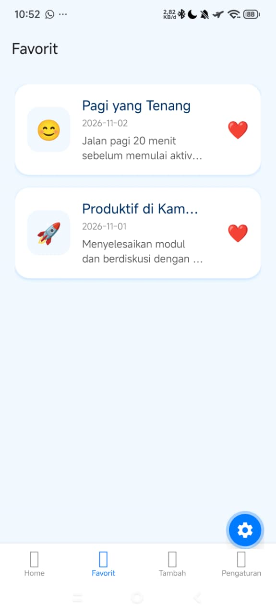
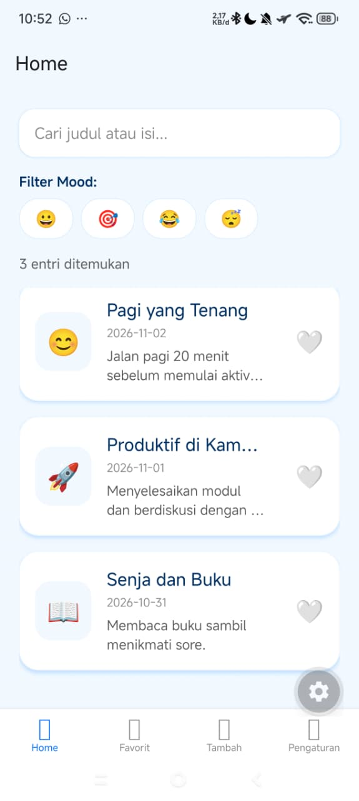

# 📓 Diary App - Mobile Programming (Pertemuan 6)

Aplikasi Buku Harian (Diary App) berbasis mobile yang dibangun menggunakan **React Native** dan **Expo Router**. Proyek ini merupakan implementasi dari pengelolaan State dan React Hooks untuk memenuhi tugas praktikum mata kuliah Mobile Programming.

## 🎓 Identitas Mahasiswa

- **Nama** : Gisal Dapa
- **NIM** : 2430511023
- **Kelas** : 5A - Teknik Informatika
- **Mata Kuliah** : Mobile Multi PLatform
- **Universitas** : Universitas Muhammadiyah Sukabumi (UMMI)

---

## 📸 Screenshots

|            Home & Filter Mood             |             Form Tambah Diary             |               Detail Diary                |                Tab Favorit                |
| :---------------------------------------: | :---------------------------------------: | :---------------------------------------: | :---------------------------------------: |
|  |  |  |  |

---

## ✨ Fitur Utama

1. **Navigasi Multi-Screen** menggunakan _Expo Router_ (Home, Favorit, Tambah, Pengaturan, Detail).
2. **Global State Management** menggunakan `useContext` untuk sinkronisasi data (entries) dan fitur _Like/Favorite_ di seluruh halaman.
3. **Pencarian Cerdas (Debounce)** untuk mencari judul atau isi diary.
4. **Filter Berdasarkan Mood** menggunakan desain UI yang modern.
5. **Tab Favorit Khusus** untuk menampilkan daftar diary yang disukai.
6. **UI/UX Modern** dengan balutan warna _Light Blue_, _rounded corners_, dan _soft shadow_.

---

## 🪝 Penjelasan 5 Hooks yang Digunakan

| Nama Hook         | Input                                                              | Output                                                                             | Dependency                       | Alasan Pemilihan                                                                                                                                                                                                |
| :---------------- | :----------------------------------------------------------------- | :--------------------------------------------------------------------------------- | :------------------------------- | :-------------------------------------------------------------------------------------------------------------------------------------------------------------------------------------------------------------- |
| **`useState`**    | Nilai awal state (cth: `""` untuk string kosong)                   | Array berisi variabel state terkini dan fungsi _setter_-nya                        | _Tidak ada_                      | Menyimpan data yang berubah secara lokal di dalam komponen, seperti teks inputan pencarian (`query`), pilihan _mood_, dan isi form penambahan diary.                                                            |
| **`useContext`**  | Objek Context (cth: `DiaryContext`)                                | _Value_ dari Provider terdekat (berisi `entries`, `likedIds`, fungsi `toggleLike`) | _Tidak ada_ (Mengikuti Provider) | Mencegah _prop drilling_. Memastikan aksi 'Like' dari tab mana pun tersinkronisasi secara _real-time_ ke seluruh aplikasi.                                                                                      |
| **`useEffect`**   | Setup _function_ (logika _timer_), dan _cleanup function_          | _Tidak ada return value_                                                           | `[query]`                        | Menangani _side effect_. Digunakan untuk membuat _timer debounce_ saat _user_ mengetik di kolom pencarian, sehingga pencarian tidak memberatkan performa aplikasi (fungsi _cleanup_ mencegah _timer_ menumpuk). |
| **`useMemo`**     | Callback _function_ untuk memproses data, dan array _dependencies_ | Nilai yang sudah di-_memoize_ (_cache_)                                            | `[entries, query, moodFilter]`   | Mencegah filter array berulang kali saat komponen di-_render_ ulang. Kalkulasi pencarian dan filter _mood_ hanya berjalan jika data atau kata kuncinya benar-benar berubah.                                     |
| **`useCallback`** | _Function_ yang ingin disimpan, dan array _dependencies_           | Fungsi yang sama (_memoized callback_)                                             | `[router]`                       | Menjaga referensi fungsi `openDetail` atau `toggleLike` tetap sama antar _render_, sehingga tidak memicu _re-render_ yang tidak perlu pada komponen anak (`DiaryCard`) saat _scroll_ daftar (FlatList).         |

---

## 🚀 Cara Menjalankan Project

1. **Clone atau Download Project**
   Pastikan Anda sudah berada di dalam folder project.
2. **Install Dependencies**
   Jalankan perintah berikut di terminal:
   ```bash
   npm install
   ```
